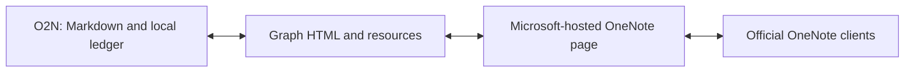

# Building A Compatible OneNote Client

O2N explores a specific goal: keep a familiar native Mac notebook experience, add Markdown-oriented tools and let colleagues continue editing supported pages in official OneNote. A useful client can be small; preserving shared content across clients is the larger engineering commitment.

## Keep The Note And The Source

Markdown and OneNote-compatible HTML serve different purposes. Markdown retains an editable source representation; HTML and resources let official clients display supported text, tables, images and attachments. Rendering a Markdown page into readable content does not preserve every fence, source spelling, annotation anchor or application-specific field.

O2N therefore keeps portable Markdown and a local ledger alongside the compatible cloud content. The ledger records page identity, baselines, asset hashes and recovery state. It is not a shared annotation service, and it is not automatically synchronized to a colleague's device. Page identity is separate from its title or local filename.

Microsoft Graph exposes HTML-based page updates. An adapter must fetch the current generated element IDs before addressing page content; the rendered representation and those API targets are not durable Markdown anchors. See Microsoft's [page-update contract](https://learn.microsoft.com/en-us/graph/onenote-update-page) and [input/output HTML reference](https://learn.microsoft.com/en-us/graph/onenote-input-output-html).

The practical requirement is a roundtrip, not just a successful upload: create or open a supported page, edit it in O2N, inspect it in the official editor, make an official-client change and reconcile it back into O2N. Verify the same page identity and actual downloaded resources, rather than trusting a cached local source file or an image tag in returned HTML.

## What The Existing Backend Does And Does Not Own

Keeping the Microsoft-hosted notebook retains an existing storage, access and official-client ecosystem. It does not hand O2N a complete synchronization engine for its own document model.

- **Microsoft-hosted state:** the shared OneNote page and its supported resources remain the cloud record that official clients use.
- **O2N responsibilities:** delegated authentication, conversion, resource transfer, refresh scheduling, source preservation, baseline comparison and user-visible conflict recovery remain client work.
- **Concurrency:** O2N reads and rechecks before writing, but that does not create an atomic cross-client transaction. A race can still occur between a recheck and a write.
- **Unsupported content:** preserving an object or refusing an unsafe edit is preferable to silently flattening or replacing content the adapter cannot represent.

Current refresh uses open/focus/wake checks and adaptive polling, not guaranteed instant delivery. Microsoft's published [change-notification](https://learn.microsoft.com/en-us/graph/change-notifications-overview) and [delta-query](https://learn.microsoft.com/en-us/graph/delta-query-overview) resource lists do not list OneNote pages as of 1 November 2026. A SharePoint change hint would still need validation against real OneNote edits and a reconciliation fallback; support for another resource does not establish reliable page-level notifications.

## A Concrete Preservation Strategy: Mermaid

Mermaid illustrates how compatible presentation and editable source can travel together.

1. Keep the authored diagram as a fenced Markdown block.
2. Render a PNG locally for clients that do not understand Mermaid.
3. Attach the UTF-8 source using a filename that binds the source hash and preview hash.
4. When importing, download both resources and validate their bytes before restoring the editable fence.
5. If either resource is missing, changed or no longer associated correctly, preserve the available image/attachment and surface the limitation. Do not reconstruct source from pixels or silently treat stale source as current.

This strategy is implemented for the supported diagram path. It is not a general cloud metadata store, and it does not mean official OneNote understands Mermaid. The [implementation](../Sources/MarkdownNotes/Diagrams.swift) and [dated acceptance record](../reconstruction/oauth-sharepoint-acceptance.md) show the exact recovery and tested-subset boundaries.

The same idea cannot simply be declared sufficient for every Markdown feature. A table edit, a normalized list or an official-client change to an unsupported object can alter the relationship between source and rendered content. Every additional preservation format needs its own validation and recovery rules.

## Where Extra Metadata Could Live

The following are design options, not three implemented products:

| Approach | Useful property | Responsibility added or retained |
| --- | --- | --- |
| Microsoft notebook plus local O2N metadata | Official clients share the supported note body; local Markdown and recovery state stay portable | Extra metadata is local unless an explicit transport is implemented; O2N owns reconciliation |
| Microsoft notebook plus shared extension metadata | Could share comments, anchors or richer source state between participating clients | Metadata storage, permissions, identity binding, versioning, orphan recovery and reconciliation across two representations |
| An independently owned notebook backend | Full control over the document and metadata model | Durability, authorization, revisions, sync, conflicts, backups, migrations, availability and any bridge to official OneNote |

Using a separate metadata store need not replace the Microsoft note body as its system of record. It does create another authoritative record for the extension data. That boundary must be explicit: which version a comment refers to, who may read it, and what happens when access to the underlying notebook changes.

A local source file is useful today even if a future shared service is never built. A prototype should not require colleagues to adopt a new client merely to read an ordinary note.

## Why Annotations Need More Than A Comment Box

Shared review comments and annotations are proposed work. General cross-client annotations are not shipped by O2N.

- **Anchor identity:** a selected text range needs a source version, surrounding context and a way to survive supported edits. A raw character offset or a freshly generated HTML element ID is not sufficient by itself.
- **Comment lifecycle:** authorship, replies, resolution, deletion, timestamps and access checks need defined semantics.
- **Reconciliation:** an external edit can move, replace or delete the referenced passage. Ambiguous anchors should become visibly unresolved; guessing a new location risks attaching a review to the wrong text.
- **Shared state:** comments intended for colleagues need a shared representation with permissions aligned to the note, plus migration, offline and recovery behavior.
- **Client capability:** unchanged official OneNote clients do not gain an O2N-specific annotation renderer just because metadata exists elsewhere.

A browser extension could add a review layer to the official web client, or an independent web client could combine OneNote content with extension metadata. Both are exploratory. The extension would depend on a changing third-party DOM, explicit permissions and reliable anchor mapping. A custom web client would own its editing, authentication and reconciliation surfaces. Neither approach proves compatibility with unchanged official desktop clients.

## Keep Local Improvements Local When Possible

Some capabilities can improve one person's workflow without adding shared state: keyboard modes, note-specific deep links, code-editing conveniences or opt-in AI assistance. They still need native focus/undo behavior, privacy choices and safe changes to the document, but they do not all require a new collaboration service. These directions are proposals, not current feature claims.

O2N's default editing experience remains the native rich editor. Markdown source and split/reading views belong behind the ribbon capability, with stable selection and undo behavior. The goal is to extend the familiar workflow, including immediate inline page and section creation, rather than make ordinary writing depend on a separate developer workspace.

The [roadmap](../ROADMAP.md) separates present behavior from these next steps. The [canonical architecture](../reconstruction/markdown-first-architecture.md) remains the implementation contract; this article does not approve a new storage service or replace it.
