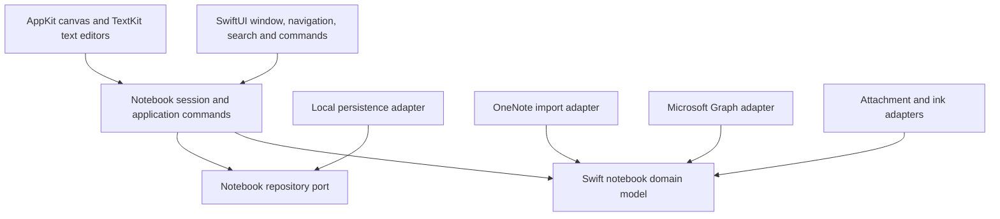

# Native Swift Reconstruction: Architecture And Method

This proposal defines an independent native Mac notebook application informed by observed OneNote behavior and documented compatibility surfaces. It is a reconstruction plan, not a claim that OneNote has already been rebuilt.

## Recommendation

**SwiftUI for the application shell; AppKit/TextKit for editing and input; a Swift-owned notebook model; explicit storage and compatibility adapters.** Reconstruct the useful notebook/canvas behavior rather than copying Microsoft's Office framework stack.

The user confirmed **local-first Mac editing first**, with import and cloud integration later. These adapters remain separate from the notebook model.

## Proposed Boundaries

The diagram shows responsibility/dependency boundaries. Compatibility adapters translate external models; they do not make Graph HTML or proprietary storage structures the application's domain model.

### Application Shell

- SwiftUI window/sidebar hierarchy for notebooks, sections, and pages; standard macOS menus, toolbar, search, focus restoration, and accessibility.
- Preserve the familiar notebook → section → page relationship. A notebook editor needs a real content surface, not an imitation ribbon full of inactive actions.
- SwiftUI is appropriate for composition and inspector controls. Bridge the editing surface with `NSViewRepresentable`; avoid relaying every keystroke through whole-document SwiftUI state replacement.
- The initial graphical shell is implemented: notebook/section/page navigation and naming, page creation, native rich-text containers, formatting, and local save/reopen. Microsoft OneNote visual/behavioral parity remains unverified.

### Editing Surface

- `NSScrollView` with an AppKit canvas hosting positioned content containers. Maintain document-space coordinates separately from viewport coordinates and zoom transforms.
- Use `NSTextView`/TextKit for text selection, keyboard behavior, IME, accessibility, spelling, paste, and undo. Apple exposes TextKit through native text views. [Apple TextKit documentation](https://developer.apple.com/documentation/appkit/textkit)
- Run an editor spike before committing to TextKit 2. Compare large attributed documents, tables, attachments, bidirectional text, nested lists, and container resizing. Validate APIs against the chosen minimum macOS version.
- Keep a structured rich-text representation with stable block/run IDs and semantic paragraphs, lists, links, tables, and attachments. `NSAttributedString` is a rendering/editing adapter, not the only persistent document format.
- Start with native view/layer rendering. Consider CoreGraphics/Metal for large ink workloads only after measured need. Do not build a text layout engine from scratch.

### Domain Model

- Notebook → section group/section → page/subpage → positioned content container → rich-text/media/ink blocks.
- Stable IDs independent from OneNote IDs. Preserve source IDs and import provenance in adapter metadata.
- Geometry in document points; viewport transforms outside the stored model. Ordered content and stacking order need explicit representation.
- Links reference stable page/block IDs; attachments are content-addressed assets with media metadata. Import must retain originals when conversion is lossy.
- The current model implements notebook/section/page and positioned text containers with optional height and an RTF payload. RTF is the initial AppKit adapter representation; a richer semantic model, section groups, subpages, media, and ink remain later extensions. Original plain-text foundation files remain readable.

### Persistence And Recovery

- Current foundation: schema-versioned JSON with validation and atomic writes, useful for transparent fixtures and model experimentation. It is single-writer and is not a production collaboration store.
- Before supporting valuable user notebooks, establish transactional local storage, schema migrations, recovery tests, and version history. Evaluate SQLite through Apple's native API or a maintained Swift library, and compare with SwiftData against migration/inspection requirements.
- Candidate production storage: SQLite metadata/content and a content-addressed attachment directory, with an explicit edit journal/outbox. A notebook package format may bundle these behind a documented extension.
- Serialize writes through an actor and reject stale revisions. Atomic JSON saves alone do not prevent lost updates between writers.
- Never substitute an empty notebook after a decode or migration failure. Preserve the file, expose the error, and offer recovery from a verified copy.

### OneNote Compatibility

- **Cloud integration:** Microsoft Graph adapter with explicit delegated sign-in. Current OneNote Graph APIs do not support app-only authentication. [Microsoft OneNote API overview](https://learn.microsoft.com/en-us/graph/api/resources/onenote-api-overview?view=graph-rest-1.0)
- **Format import:** independently parse documented [MS-ONE](https://learn.microsoft.com/en-us/openspecs/office_file_formats/ms-one/) and [MS-ONESTORE](https://learn.microsoft.com/en-us/openspecs/office_file_formats/ms-onestore/) behind a read-only importer. These are separate layers: semantic content and revision-store representation.
- Graph page HTML is not a lossless OneNote file model. Test ink, equations, positioning, embedded files, tables, links, and unsupported objects individually. Record unsupported features rather than silently dropping them.
- Begin with import/readback, then explicit export. Cloud writes and two-way synchronization follow fidelity tests, conflict handling, retry/idempotency design, and a user-approved sign-in flow.
- Do not reuse Microsoft's private credentials, app IDs as our identity, internal app-group data, or private client sync implementation. Graph access needs our own registered application.

## Product Design Proposal

- **Work area:** native sidebar hierarchy, page list, and spacious document canvas; command controls appear in a standard Mac toolbar or contextual formatting surface.
- **Canvas:** create a text container by clicking empty space; select a container to reveal move/resize affordances. Text selection and object selection must be visibly distinct.
- **Text:** use platform text controls and semantic styles. Default font and content width are product decisions to validate with real notes, not copied binary constants.
- **States:** unsaved/saving/saved/error, empty notebook, corrupt notebook/recovery, offline, importing, unsupported content, and sync conflict. Each state must preserve edits and provide a concrete next action.
- **Accessibility:** keyboard traversal, VoiceOver notebook/page names, text navigation, contextual actions, visible focus, and reduced-motion behavior.
- **Original assets:** keep Microsoft icons/fonts/JS as research references only. New UI uses original assets or appropriate system symbols.

## Reconstruction Method

1. **Preserve a build:** immutable archives, per-file hashes, signatures, tool versions, command logs, and architecture slice. Completed for the captured build.
2. **Map responsibilities:** imports, Objective-C classes, ribbon structure, JS bundles, selected assembly/pseudocode. Completed at the limited scope documented in the research report.
3. **Write behavioral contracts:** synthetic native tests now cover text editing, formatting, undo/redo, corruption, failed-save recovery, and save/reopen. Reference OneNote behavior, import fidelity, and manual accessibility tests remain to be recorded.
4. **Build a vertical slice:** implemented one local notebook with sections/pages, editable text containers, native text undo, and atomic local save/reopen. Page navigation clears undo history to avoid invisible native text-view targets. Full window/keyboard/VoiceOver interaction testing remains separate from the owned-view checks.
5. **Extend by capability:** positioned containers, rich text/lists, tables, attachments, search, links, ink, export, and compatibility. Each capability has its own fixtures and acceptance evidence.
6. **Validate parity:** compare reference behavior with the Swift application using the same fixtures, viewport dimensions, and interaction sequence. Maintain explicit supported/partial/unsupported statuses.
7. **Harden:** migrations, crash recovery, accessibility, performance, packaging/signing, and only then two-way sync or collaboration.

Pseudocode is evidence for hypotheses. An independently written behavior specification is the implementation contract. The current author has inspected the original binary; this is not a claim of a legally formal clean-room process.

## Verification Matrix

- **Editing:** Tamil/English IME, combining characters, emoji, bidirectional text, large paste, multilevel lists, selections across blocks.
- **Canvas:** click/type, move/resize, zoom anchoring, selection at different zoom levels, scrolling, keyboard object movement.
- **Persistence:** exact IDs/content/geometry after reopen, interrupted write, corrupt file, unsupported schema, concurrent stale writer, migration rollback.
- **Compatibility:** per-feature import fixtures, original asset retention, unsupported-content diagnostics, round-trip loss accounting.
- **Sync:** delegated authentication, throttling, offline edits, duplicate retries, conflict copies, source-version mismatches; no silent last-writer-wins data loss.
- **Performance:** establish measured budgets on agreed reference hardware before making responsiveness claims.

## Implemented Foundation

The Swift package separates notebook core, persistence, native editor, and development tooling. The `OpenOneNoteMac` executable supplies the app lifecycle and menus; `openonenote-dev` owns project checks, build/sign/package, and research capture. Tests exercise real AppKit text editing and formatting, undo/redo, Unicode/RTF persistence, geometry, error preservation, process boundaries, and Swift-only automation. Production transactional storage, import/export, ink, attachments, and sync are not implemented. The local `.app` has an ad-hoc development signature and is not notarized.
