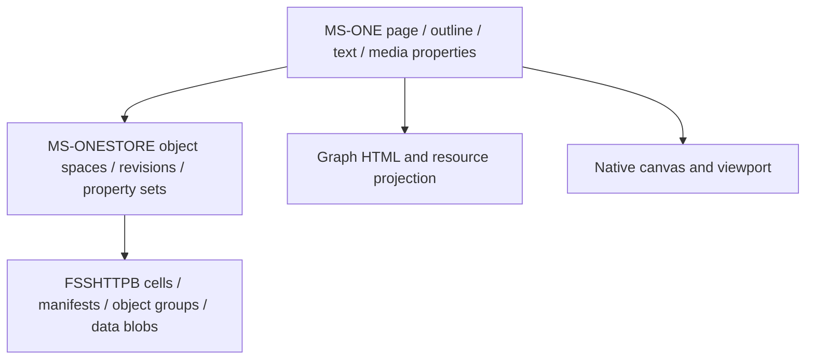

# Document And Canvas Model

This document separates OneNote's published binary content/revision layers from its Graph HTML projection and the native canvas behavior observed in a synthetic fixture.

## Content Representation

- **Specification — outline objects:** an outline contains text, lists, tables, or images, can occupy arbitrary page positions, and can overlap another outline. A page can exist without an outline. [MS-ONE outline](https://learn.microsoft.com/en-us/openspecs/office_file_formats/ms-one/22e65fbe-01db-4c3f-8b00-101a6cd6f9c4)
- **Specification — rich text:** `jcidRichTextOENode` has JCID `0x0006000E`; Unicode text takes precedence over the alternative extended-ASCII property. Text-run properties carry formatting separately. This is structured binary storage containing textual values, rather than a plain-text notebook file. [Rich-text property set](https://learn.microsoft.com/en-us/openspecs/office_file_formats/ms-one/980fae36-b5dd-4581-bf1e-5ab54177153d)
- **Specification — run boundaries:** character positions delimit runs in the corresponding Unicode string. An importer must interpret these positions in the documented string representation rather than count Swift grapheme clusters. [TextRunIndex](https://learn.microsoft.com/en-us/openspecs/office_file_formats/ms-one/f5ae3d7a-09dd-4904-a8bd-7a529d8067c3)
- **Specification — object properties:** page/outline children, layout bounds, pictures, list properties, and history are explicit properties. [MS-ONE property inventory](https://learn.microsoft.com/en-us/openspecs/office_file_formats/ms-one/e9bf7da8-7aab-4668-be5e-e0c421175e3c)
- **Static — native host:** the previous main-binary sample constructs `OIInkInputAdaptor` from `ONPageView`. This establishes an ink input integration, not an ink persistence decoder. [Existing page-view sample](../../research/decompiled/16.114.1/ONPageView_method_10026dbe8.c)
- **Untested — ink/equations/audio:** no synthetic native handwriting, equation, audio, or embedded Office document was created here. Their lossless Graph round trip remains unproven.

## Three Distinct Graphs

**Specification:** ONESTORE persists cross-referenced object spaces and property sets with a transaction log. It can represent standalone files or content transmitted through FSSHTTP/FSSHTTPB. [ONESTORE applicability](https://learn.microsoft.com/en-us/openspecs/office_file_formats/ms-onestore/83daaabe-53ba-4e6e-a56d-cc5cd41bbb1f)

**Inference:** storage objects, transport cells, user-visible page history, and undo entries are different identities/lifetimes. They must not be collapsed into one `revision` field in a new application.

## Synthetic HTML Results

**Observed — Graph, not native rendering:** the canvas fixture initially supplied main and side containers at `48/120/720px` and `820/250/280px` respectively. Readback preserved those values, English/Tamil/emoji, a two-item unordered list, and a two-cell table. Bold and italic became styled spans. Font size `14pt` appeared on main text runs; the body retained a separate `11pt` default. A border declared on the input table was returned as `border:0px` on the table/cells; this does not establish that per-cell border input fails. [Before replacement fixture](../../research/sync/runtime/remote-beta.sanitized.html)

**Observed — content versus geometry:** a replacement targeting the freshly returned outer-div ID succeeded and replaced its children. Its requested width `750px` was ignored: readback retained `720px`. The synthetic main table/list/earlier append disappeared as expected from that content replacement; the side container survived. [After replacement](../../research/sync/runtime/after-outer-replace.sanitized.html)

**Specification:** Graph normalizes input HTML and regenerates output structures/IDs; it is not an opaque native document channel. [Input/output HTML](https://learn.microsoft.com/en-us/graph/onenote-input-output-html) The documented update surface restricts positioned outer-div replacement and warns generated IDs can change. The successful content replacement above must not be advertised as supported container resizing. [Update contract](https://learn.microsoft.com/en-us/graph/onenote-update-page)

## Embedded File Result

**Observed — Graph:** a second synthetic page accepted a multipart text-file attachment, returned an `object` with a Graph resource URL, and downloaded the exact 47 input bytes. Resource URLs used an identity-specific root rather than the hardcoded `/me` spelling expected by the first downloader. The tool subsequently followed only the resource obtained from this owned page, retaining host/path templates without account identifiers. [Attachment fixture](../../research/sync/runtime/attachment.sanitized.html)

**Inference:** model a file as an owned asset plus a stable application reference. Do not substitute a rendered icon or the HTML `object` wrapper for its original bytes.
