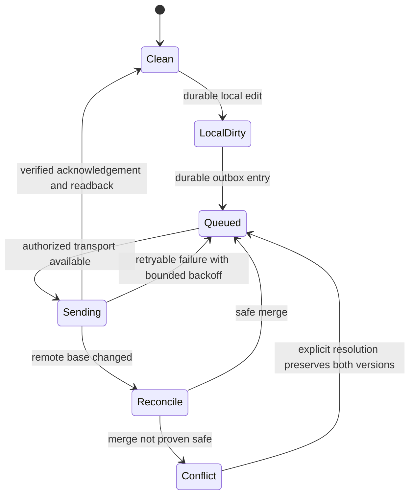

# Edit And Synchronization Sequences

This document separates the observed synthetic Graph sequence from a native synchronization reconstruction whose unmeasured transitions are explicitly labeled.

## Observed Synthetic Service Sequence

```mermaid
sequenceDiagram
    participant Probe as Swift probe / sanctioned m365 CLI
    participant Graph as Graph OneNote API
    Probe->>Graph: Create synthetic notebook, section, canvas page
    Graph-->>Probe: Object identities (private local registry)
    Probe->>Graph: GET content with generated IDs
    Graph-->>Probe: Normalized HTML, two positioned divs
    Probe->>Graph: PATCH append REMOTE-BETA
    Probe->>Graph: GET content
    Graph-->>Probe: Marker present
    Probe->>Graph: Replace main div by fresh generated ID, request width 750px
    Probe->>Graph: GET content
    Graph-->>Probe: Children replaced; original width 720px retained
    Probe->>Graph: Create attachment page; GET resource bytes
    Graph-->>Probe: Exact 47-byte synthetic payload
    Probe->>Graph: Two reads of conflict paragraph
    Graph-->>Probe: Same generated ID
    Probe->>Graph: Writer A replaces paragraph
    Probe->>Graph: Writer B replaces using stale ID
    Graph-->>Probe: CLI reports failure; HTTP detail unavailable
    Probe->>Graph: Final GET
    Graph-->>Probe: Writer A present, writer B absent
```

The native application was not a participant in this measured sequence. A Graph success does not establish native propagation or a specific server revision token. Timestamps and durations are in the [experiment events](../../research/sync/runtime/graph-events.jsonl).

## Native Local Edit: Static/Specification Reconstruction

```mermaid
sequenceDiagram
    participant Editor as Native editor
    participant Store as Local object/revision cache
    participant Queue as Content scheduler
    participant Transport as CSI batch/worker
    participant Server as Notebook backend
    Editor->>Store: Local content/geometry change (inferred; unmeasured)
    Store->>Queue: Dirty work becomes schedulable (inferred)
    Queue->>Transport: Submit job and callbacks (static path)
    Transport->>Transport: Select service path; serialize cell/data elements (static paths)
    Transport->>Server: Exchange changes and knowledge (protocol contract; wire unobserved)
    alt Coherency failure
        Server-->>Transport: Failure / current state (specification)
        Transport->>Store: Download and reconcile (specification)
        Store-->>Editor: Preserve unresolved conflict (required contract; untested)
    else Acknowledged
        Server-->>Transport: Accepted state (specification)
        Transport->>Store: Advance acknowledged base (inferred)
    end
```

This sequence connects investigated responsibilities; it is not a recovered complete main-to-CSI call graph. Keystroke-to-cache, dirty notification, exact persist-before-send ordering, and acknowledgement handling were not traced live.

## Native Remote Edit: Static/Inference Reconstruction

```mermaid
sequenceDiagram
    participant Other as Other authorized client
    participant Server as Notebook backend
    participant RTC as Notification / health path
    participant Sync as CSI sync work
    participant Store as Native cache / indexes
    participant Editor as Native editor
    Other->>Server: Remote edit (native test unperformed)
    Server-->>RTC: Invalidation or other notification (inferred; payload unobserved)
    RTC->>RTC: Subscription, RTC status, heartbeat/grace handling (static)
    RTC->>Sync: Conditional downstream dispatch (static; semantics partial)
    Sync->>Server: Query changes/knowledge (specification; timing unmeasured)
    Server-->>Sync: Changed elements (specification)
    Sync->>Store: Reconcile and update derived state (inferred)
    Store-->>Editor: Refresh while preserving local edits (required contract; untested)
```

The build contains notification and timer paths, so a universal “poll every N seconds” model is unsupported. The active account's channel, polling fallback, debounce and receipt latency still require a controlled native experiment.

## Independent Client State Contract



**Proposed**, not implemented by this PR. Local durability and server acknowledgement must remain distinct; failed decoding/authentication cannot transition silently to `Clean`.
